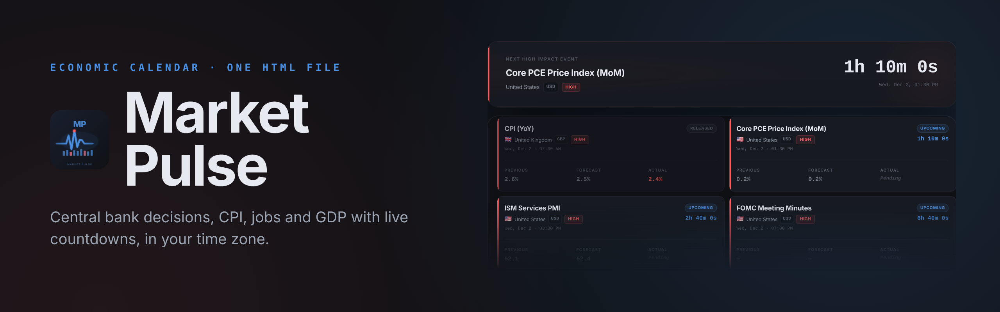
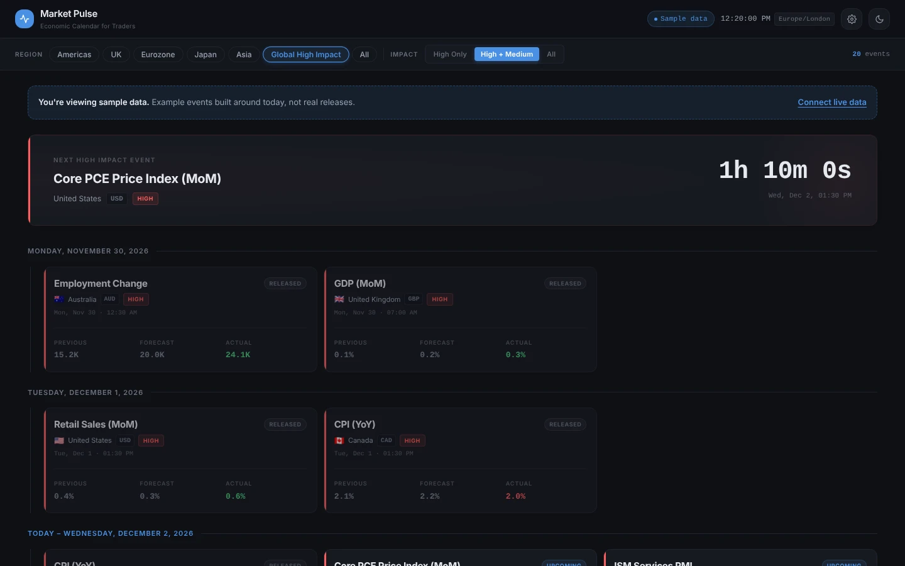
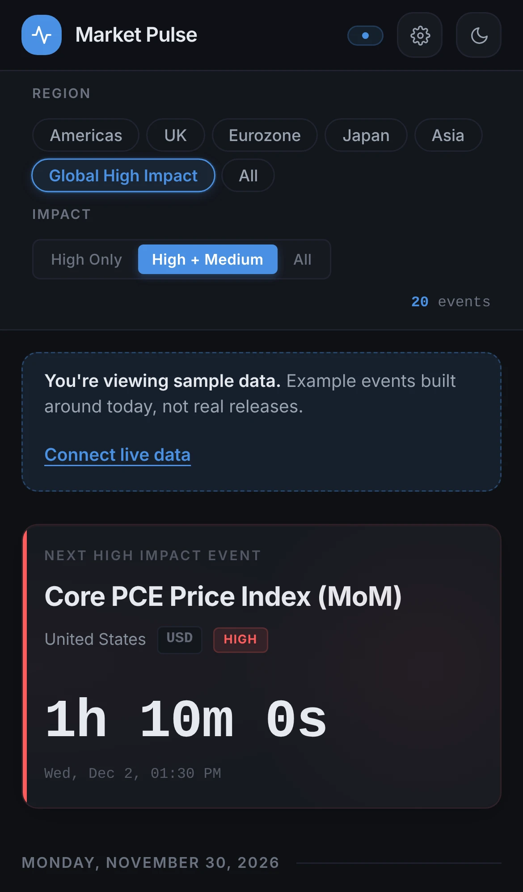
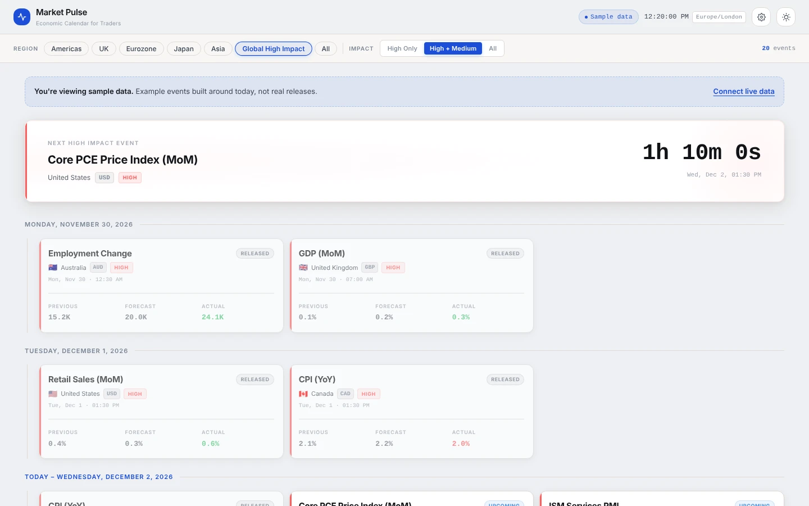

<p align="center">
  <a href="https://shazmoghaddam.github.io/market-pulse/">
    
  </a>
</p>

# Market Pulse

[](https://github.com/ShazMoghaddam/market-pulse/actions/workflows/ci.yml)
[](LICENSE)
[](CHANGELOG.md)
[](https://shazmoghaddam.github.io/market-pulse/)


A distraction-free economic calendar for traders. Central bank decisions, CPI, jobs and GDP releases, with live countdowns in your own time zone. One HTML file, no ads and no sign-up.

**[Open the live demo →](https://shazmoghaddam.github.io/market-pulse/)**

**Contents:** [Features](#features) · [Screenshots](#screenshots) · [Live data](#live-data) · [How it works](#how-it-works) · [Customise it](#customise-it) · [Run it](#run-it) · [Layout](#layout) · [Not financial advice](#not-financial-advice)

## Features

- **Next high-impact event** front and centre, with a big live countdown.
- **Live status:** events move from Upcoming to Live to Released on their own, with countdowns ticking every second.
- **Better or worse than expected:** each actual figure turns green or red against the forecast. Jobless figures are flipped, because a higher number there is bad news.
- **Filters:** Americas, UK, Eurozone, Japan, Asia or global high-impact events, and High, High + Medium or all impact levels. Your choice is remembered.
- **Your time zone**, detected automatically.
- **Dark and light themes**, following your device until you pick one.
- **Always a useful demo.** Without an API key it shows a sample week built around today, clearly labelled, so it never goes out of date.
- **One file.** Open `index.html` in any browser. No build step.

## Screenshots

<table>
  <tr>
    <td width="66%"></td>
    <td width="34%" rowspan="2"></td>
  </tr>
  <tr>
    <td></td>
  </tr>
</table>

## Live data

Market Pulse can load real events from the [TradingEconomics API](https://tradingeconomics.com/analytics/api.aspx).

1. Get an API key from TradingEconomics.
2. Open Market Pulse and click the **gear icon** (or **Connect live data**).
3. Paste your key and click **Save**.

The badge turns green and reads **Live**, and the calendar refreshes every minute. If TradingEconomics can't be reached, Market Pulse shows the last events it saved and says **Offline**.

**Your key stays private.** It is saved only in your own browser and sent only to TradingEconomics. It is never written into the file, so hosting the page publicly is safe: each visitor adds their own key.

Market Pulse is not affiliated with TradingEconomics.

## How it works

- **Sample week.** Each sample event is stored as "business days from today" plus a UTC time, so the demo always sits around the current week and skips weekends. Events that have already happened show their example actual figure.
- **Status engine.** An event is *Live* from five minutes before its time until its actual figure arrives (or two hours pass), then *Released*.
- **Cache.** Live events are saved in your browser for 30 minutes, so a brief outage doesn't empty the calendar.
- **Safe rendering.** Everything from the API is escaped before it reaches the page, so a bad or malicious value can only ever show up as text.

## Customise it

Everything is in `index.html`:

| What to change | Where to look |
|---|---|
| Default region filter | `DEFAULT_REGION` in `CONFIG` |
| Default impact filter | `DEFAULT_IMPACT` in `CONFIG` |
| Refresh rate and cache time | `REFRESH_INTERVAL_MS` and `CACHE_TTL_MS` |
| Accent colour | `--accent-primary` in the CSS |
| Sample events | the `sampleWeek` block (`"day"` is business days from today, `"time"` is UTC) |

A full walkthrough for buyers is in the [user guide](market-pulse-user-guide.html), and the [privacy policy](market-pulse-privacy-policy.html) explains what is stored.

## Run it

Open `index.html` in a browser. That's it.

To run the tests or rebuild the images, you need Node 20 or later:

```bash
npm install
npx playwright install chromium
npm test                 # smoke tests, with the TradingEconomics API mocked
npm run build:assets     # banner, social preview and screenshots
```

## Layout

```
index.html                       the whole app: markup, styles, sample week and script
market-pulse-user-guide.html     user guide
market-pulse-privacy-policy.html privacy policy
icon_512.svg                     app icon and favicon
assets/
  banner.png                     README banner
  social-preview.png             GitHub social preview (Settings > Social preview)
  screenshots/                   README screenshots
  build.mjs                      builds all of the above from the live page
scripts/serve.mjs                tiny static server used by the build and tests
tests/smoke.mjs                  headless browser tests, run in CI
```

## Not financial advice

Market Pulse shows scheduled economic events. It does not give trading advice, and sample data is for demonstration only.

## Licence

[MIT](LICENSE)

---

Created by **Shaz Moghaddam** · London  
[Website](https://shazmoghaddam.github.io/) · [LinkedIn](https://www.linkedin.com/in/shazmoghaddam/)
